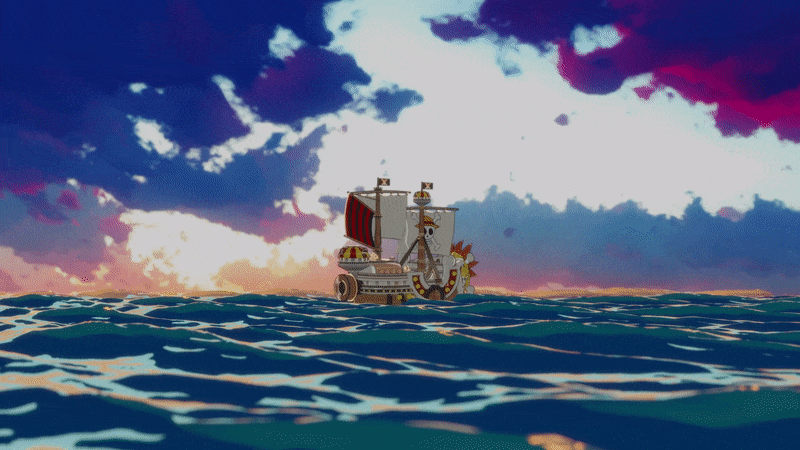
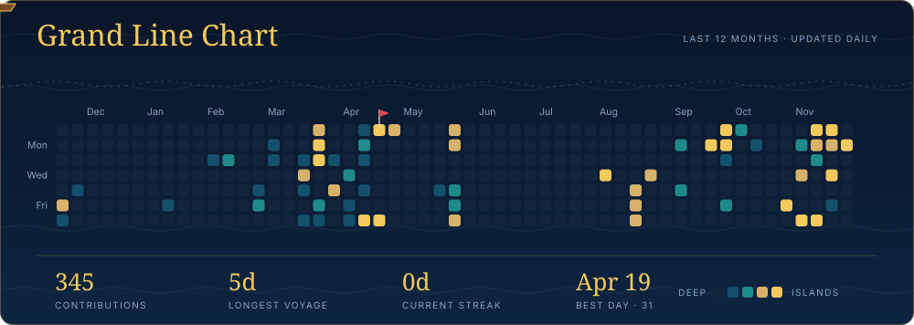

<!-- NIGHT VOYAGE theme, Grand Line edition: built by scripts/build.py, chart refreshed daily by .github/workflows/widgets.yml -->

  
  
  
  
  
  

  
  

  
  

   
   
   
   
   
  also: React Native · Pandas · NumPy · Stripe · DigitalOcean · Odoo · Sitecore · Claude, OpenAI and Gemini APIs

  

