<!-- NIGHT VOYAGE theme, Grand Line edition: built by scripts/build.py, chart refreshed daily by .github/workflows/widgets.yml -->

<a href="https://zhengyaoportfolio.vercel.app/recruiter"></a>

  

  
  
  
  
  
  




  <a href="https://github.com/ashzaeen/FinVantage">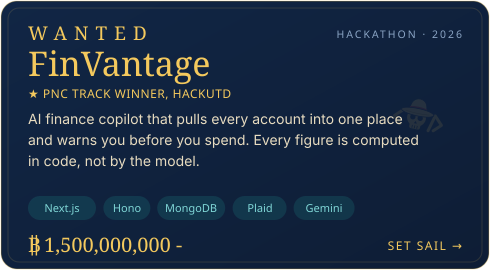</a>
  <a href="https://github.com/Zhao9114/CSE3311_resumeBuilder">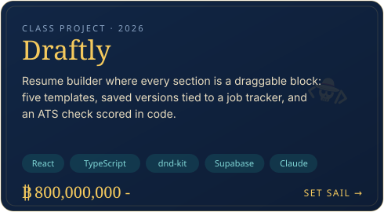</a>

  <a href="https://github.com/Zhao9114/bacteria_annotation">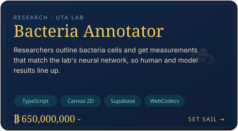</a>
  <a href="https://github.com/kztJames01/hackUTA"></a>


   
   
   
   

<a href="mailto:zhengyaowong.cs@gmail.com"></a>

  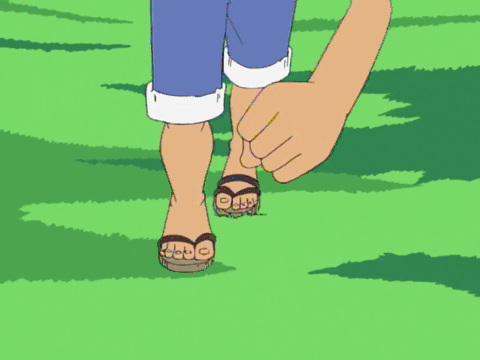

